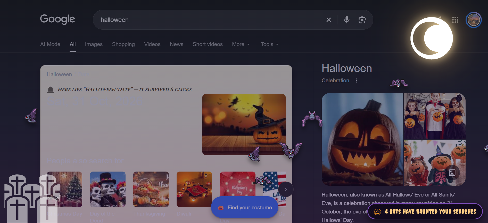

# Halloween : Google Mod

 # (*Your Google, but it died as it lived: haunted.*)

(*A [Tampermonkey](https://www.tampermonkey.net/) userscript that drags Google Search into
a graveyard — but **only** when your query contains the word `halloween`. Search for
"cat food" and Google acts like nothing happened. It's a polite haunting.*)

(*Specially made for halloween with google(yeh*)

## Get it running(for chrome) 

1. Install [Tampermonkey](https://www.tampermonkey.net/) if you don't have it. (: 

**Note for chrome 138+ users:** open `chrome://extensions` and click **Tampermonkey -> Details:**, and turn ON **"Allow user scripts"**.(Now chrome makes userscripts sit in timeot before they can run.)

2. Open [`halloween.user.js`](halloween.user.js) -> copy it.

3. Go to Tampermonkey extension in chrome and add the script.

4. Go to [google.com](https://www.google.com) and search `halloween`(only if you wants to .. mrrp)

5. Screams , bats fun.

## Screenshot: 

(*AI was only used to finalize the idea for this project and no code or assets is ai generated*)
(*All the assets used is collected  from internet*)

------------------------------------------------------------------------

Made by a teen for [hackclub ysws](https://crescent.hackclub.com/) on halloween .. ＞﹏＜
